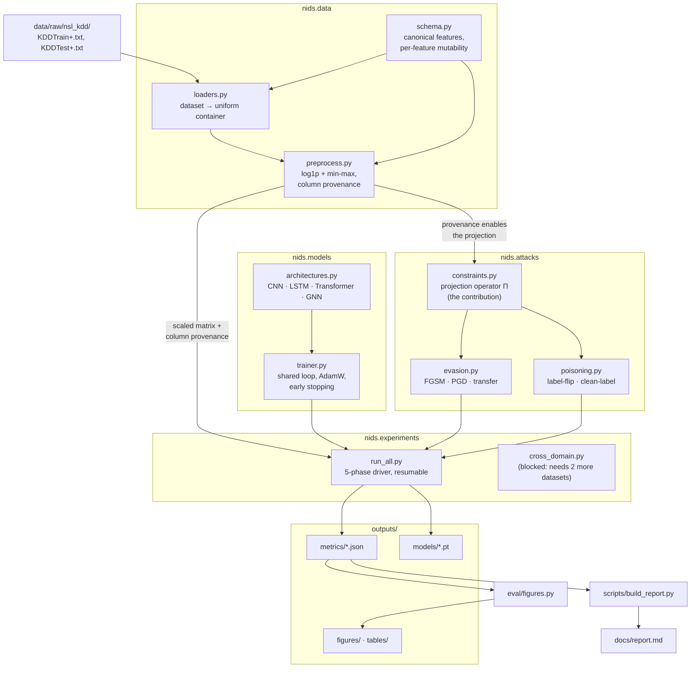
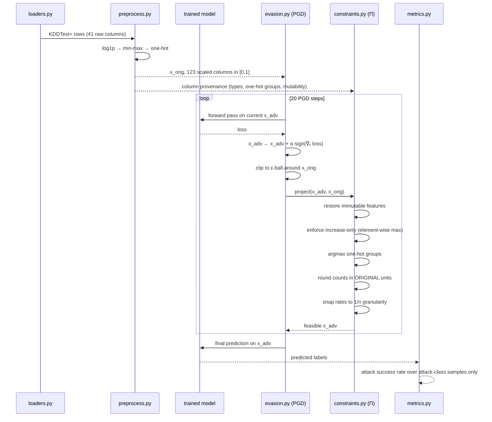

# Project Documentation — Adversarial Robustness & Cross-Domain Transferability of Deep-Learning NIDS

> **How to read this file.** This is a ground-up explanation of the project for the person who
> built it, written for learning and for interview preparation. Every number quoted is read
> from a completed run in `outputs/`, not estimated. Technical terms are explained the first
> time they appear.
>
> **Where information is missing, it says so.** The project is not a git repository, so there
> is no commit history, no record of reverts or abandoned branches, and no timestamps for the
> build. There are also zero `TODO`/`FIXME` markers in its 4,506 lines of Python. Sections that
> depend on that missing history are marked **[NEEDS YOUR INPUT]** and contain questions rather
> than invented answers.
>
> Last updated: 2026-08-25, after all five NSL-KDD experiment phases completed.

---

## 1. Project Overview

This project is a research codebase that studies how deep-learning **network intrusion
detection systems** (NIDS — software that watches network traffic and flags connections that
look like attacks) fail when someone deliberately tries to fool them, and asks whether those
failures are real or artefacts of an unrealistic way of measuring them.

The published literature reports that deep-learning intrusion detectors collapse under
**adversarial attack** — small, deliberately-computed changes to an input that cause a model to
misclassify it — with evasion success rates approaching 100%. This project reproduces those
numbers and then asks a question the standard method skips: *could the adversarial network
traffic actually be transmitted?* For flow-based intrusion detection the answer is usually no.
The project defines a mathematical operator that projects any proposed adversarial traffic onto
the set of physically realisable network flows, re-runs every attack under it, and measures how
much of the published threat survives. It is for security researchers and for anyone evaluating
whether a machine-learning detector is deployable.

---

## 2. Motivation — the "Why"

### 2.1 The technical gap (established from the code and results)

Adversarial machine learning grew up on images. In that setting the threat model — the set of
assumptions about what an attacker can do — is simple and roughly correct: an attacker can
change any pixel by a small amount in any direction, because any array of pixel values is a
valid image. Network traffic does not work that way, but the standard evaluation method was
carried across unchanged.

Run an unconstrained gradient attack on network flow features and it proposes records like
these, all of which the code in `attacks/constraints.py` exists to reject:

| Proposed adversarial value | Why it cannot exist |
|---|---|
| `duration = −0.4 s` | time does not run backwards |
| `src_bytes = 1204.7` | bytes are integers |
| `protocol_type = 0.3·tcp + 0.7·udp` | a packet has exactly one protocol |
| `src_bytes = 12,000,000`, `duration = 0.001` | ≈ 12 GB in a millisecond |
| `serror_rate = 0.83`, `count = 1` | a rate over one connection is 0 or 1 |
| attacker *reduces* `dst_bytes` | the victim sent those bytes, not the attacker |

An adversarial example that cannot be transmitted is not an attack. This project's measurement:
**100% of unconstrained adversarial flows violate at least one physical constraint.** If every
adversarial example in an evaluation is unsendable, the reported attack success rate is
measuring something other than security.

There is a second gap. NSL-KDD, the most-used benchmark in this field, ships with an official
train/test split in which the test file deliberately contains attack families absent from
training — a **zero-day test** (zero-day meaning an attack never seen before). Measured here
with a simple logistic-regression control, that split costs 23 accuracy points versus an
ordinary same-distribution split (74.37% against 97.98%). Papers reporting ~99% on NSL-KDD have
shuffled the two files together, which destroys exactly the property that makes the benchmark
worth using.

### 2.2 The personal motivation **[NEEDS YOUR INPUT]**

The repository cannot tell me why *you* built this. To write this section honestly I need:

1. What is this for — MSc/BSc dissertation, PhD chapter, coursework, paper submission, or
   portfolio? Any institution or deadline to reference?
2. Solo or team work? If team, which parts were yours?
3. Did the realizable-constraints idea (RO2) exist from the start, or did it emerge *after* you
   saw unconstrained attacks hitting ~100% and found the result implausible? This materially
   changes the story — "I set out to test a threat model" and "I found a result I didn't
   believe and chased it" are different and both are good, but only one is true.

---

## 3. Tech Stack

Every dependency, why it was chosen, and what would have gone wrong otherwise. The
justifications marked *(documented in the repo)* are stated in `requirements.txt` or the
methodology chapter; the rest are inferred from the code and marked as such.

### Python 3.11

The default language for machine-learning research: every relevant library, dataset loader and
numerical tool targets it first.

*Alternative:* R or Julia. *Consequence of switching:* neither has a mature adversarial-attack
or deep-learning ecosystem comparable to PyTorch's, so the attack code and the model code would
both have had to be written from scratch against a thinner numerical base.

### PyTorch ≥ 2.0 — models, training, and gradient-based attacks

A deep-learning framework. Its relevant property here is **autograd** (automatic
differentiation — the ability to compute the derivative of any output with respect to any
input). Adversarial attacks *are* gradient computations with respect to the input rather than
the weights, so a framework with first-class input gradients is not a convenience but the core
requirement.

*Alternative:* TensorFlow/Keras or JAX. *Consequence:* TensorFlow's eager-mode input gradients
are workable but its graph mode makes the "perturb, project, re-evaluate" loop in
`attacks/evasion.py` considerably more awkward, because the projection operator is ordinary
imperative Python with data-dependent branching. JAX would suit the attack loop well but its
functional style and immature RNN support would have complicated the LSTM.
**[NEEDS YOUR INPUT: was this a considered choice or simply what you already knew?]**

### The CPU build of PyTorch, specifically

*(documented in the repo)* Installed from the CPU wheel index. The CPU wheel is ~200 MB against
~2.5 GB for the default CUDA build.

*Consequence:* this decision shapes the entire project's tempo. Every experiment is bounded by
single-machine CPU throughput; the poisoning phase alone required 64 full model retrainings and
took 8.95 hours. The trade bought reproducibility on any machine and avoided a GPU dependency,
at the cost of experiment turnaround measured in hours rather than minutes.

### NumPy ≥ 1.24 and pandas ≥ 2.0 — data handling

NumPy provides the array type everything else speaks; pandas provides the labelled table used
during dataset loading, before conversion to arrays.

*(documented in the repo)* A specific compatibility note is recorded: pandas 3.x introduced a
dedicated `str` dtype, and `data/loaders.py` accounts for it when detecting which columns are
categorical. Without that handling the loaders would mis-classify string columns on new pandas
versions.

### scikit-learn ≥ 1.3 — splits, metrics, and control baselines

Used for train/validation splitting, class weighting, and — importantly — the **control
models**. A control is a deliberately simple model included so that the deep models' results
mean something by comparison. Here: logistic regression (a linear classifier) and a random
forest (an ensemble of decision trees).

*Why this matters:* the controls produced one of the study's load-bearing findings. Logistic
regression scoring 97.98% on a same-distribution validation split and 74.37% on the official
test split is what proves the 23-point gap is a property of the *data split*, not of any
particular deep architecture. Without a control that result would have been unattributable.

### matplotlib ≥ 3.7, seaborn ≥ 0.12, tabulate ≥ 0.9 — outputs

matplotlib draws the six figures; seaborn is used for the transfer-matrix heatmap; tabulate
backs `DataFrame.to_markdown()` so tables land in the report already formatted.

### Deliberately rejected dependencies

These are worth knowing because interviewers ask about them, and the reasoning is recorded in
`requirements.txt`.

**`torch-geometric`** — the standard graph-neural-network library. *Rejected because* it is a
heavy dependency that is sensitive to the exact CUDA version, and because the GNN here needs
only k-nearest-neighbour message passing, which is implemented directly in
`models/architectures.py`. *Consequence of the choice:* the message-passing arithmetic stays
visible in the source and the project installs cleanly anywhere; the cost is that more
sophisticated graph operations would have to be hand-written.

**`adversarial-robustness-toolbox` / `foolbox`** — the standard adversarial-attack libraries.
*Rejected because* this project's entire contribution is a custom projection operator onto the
realisable-traffic set, and neither library exposes a hook to insert one into the attack loop.
FGSM and PGD are about 60 lines each when written directly. *Consequence:* full control and
full transparency, at the cost of having to validate the attack implementations yourself —
which the project does, via a documented sanity check in §14.3 of the report.

---

## 4. Architecture

This is a research library plus an experiment driver, not a client/server application. There is
no frontend, no database, and no network service. The structure is a pipeline: raw dataset files
in, trained models and JSON result files out, figures and a report assembled from those.

### 4.1 Package structure

```
D:\NIDS\
├── src/nids/
│   ├── data/         schema, loaders, preprocessing
│   ├── models/       four architectures + shared training loop
│   ├── attacks/      constraints (the contribution), evasion, poisoning
│   ├── eval/         metrics, figures
│   └── experiments/  run_all (5-phase driver), cross_domain
├── scripts/          report builder, result summariser, Colab notebook builder
├── tests/            constraint test suite (10 tests)
├── data/raw/         datasets
├── docs/             three-part report + this file
└── outputs/          models, metrics, figures, tables, logs, adversarial samples
```

### 4.2 How the components connect



### 4.3 The one non-obvious dependency

The arrow from `preprocess.py` to `constraints.py` labelled *"provenance enables the
projection"* is the architectural heart of the project and the reason the preprocessing module
tracks **column provenance** — a record of which original feature each column of the scaled
matrix came from, and how it was transformed.

The projection operator has to answer questions like "is this column an integer count, and if
so what does 0.6231 in scaled space correspond to in bytes?" and "which group of columns forms
the one-hot encoding of `protocol_type`?" A model sees only an anonymous 123-column float
matrix. The projection needs the semantics behind those columns. Without provenance tracking,
constraints could only be expressed in meaningless scaled units — which, as §4.2 of the report
notes, is why integrality has to be enforced in *original* units: under log1p scaling one scaled
unit spans a fraction of a byte near zero and millions of bytes near one.

---

## 5. Workflow / Data Flow

### 5.1 The five phases

| Phase | What it does | Cost on this machine |
|---|---|---|
| 1 | Train four architectures on clean data | ~39 min |
| 2 | White-box evasion: {FGSM, PGD} × {constrained, unconstrained} × 4 budgets | ~22 min |
| 3 | Black-box transfer, all 16 (surrogate, target) pairs | ~3 min |
| 4 | Poisoning: 4 conditions × 4 rates × 4 architectures = 64 retrains | ~9 h |
| 5 | Adversarial-training defence, 4 architectures | ~1.5 h |

*White-box* means the attacker has the model's weights and can compute gradients through it.
*Black-box* means they cannot, and must attack a substitute model and hope the result transfers.

### 5.2 End-to-end flow of a single constrained evasion attack



The projection runs **inside** the loop, after every step, not once at the end. This is the
standard projected-gradient formulation: the iterate stays inside the feasible set throughout,
so the attacker is optimising within the realisable region rather than optimising freely and
then being clipped back. Projecting only at the end would understate the attacker's ability,
which would be a different and unfair experiment.

### 5.3 A concrete walk-through

Take a real SYN-flood record from `KDDTest+`, correctly detected by the CNN. The attacker wants
it classified benign.

1. **Preprocessing.** The raw record has `duration = 0`, `protocol_type = tcp`,
   `src_bytes = 0`, `count = 511`, `serror_rate = 1.00`. After `log1p` and min-max scaling, and
   one-hot expansion of the three categorical columns, this becomes a 123-element vector in
   [0, 1].

2. **Gradient step.** PGD computes the gradient of the loss with respect to that vector and
   steps in the direction that most increases the chance of a "benign" prediction. Left
   unconstrained, this step wants to *lower* `src_bytes` below zero, *lower* `duration`, turn
   `protocol_type` into a 0.3/0.7 mixture of TCP and UDP, and set `serror_rate` to 0.83.

3. **Projection.** Every one of those is rejected. `protocol_type` is immutable and attack-
   defining — a SYN flood switched to UDP is a different attack, so it snaps back to TCP.
   `duration` and `src_bytes` are increase-only, so the attempted decrease is clamped to the
   original value by an element-wise maximum. `serror_rate` is derived from `count = 511`, so
   it must be a multiple of 1/511 and is snapped to the nearest achievable value. What remains
   is a genuine but much smaller set of moves: pad `src_bytes` upward, add delay to `duration`,
   open more connections.

4. **Repeat 20 times**, then evaluate. At ε=0.01 the CNN's attack success rate under this
   procedure is **0.057**. The same attack without the projection reports **0.999** — a
   17.5× overstatement, and the single most important number in the project.

---

## 6. Project Timeline

### 6.1 What is precisely known: the final experiment run

I have exact timings for the experiment execution, because I ran and monitored it. All times
are 2026-08-25.

```mermaid
gantt
    title Final NSL-KDD experiment run (measured, 2026-08-25)
    dateFormat HH:mm
    axisFormat %H:%M

    section Setup
    Patch rate grid + checkpointing   :01:12, 10m
    Subset smoke test (found a bug)   :01:19, 8m
    section Phase 4 - poisoning
    CNN 16 cells                      :01:22, 123m
    Killed externally, resumed        :crit, 02:54, 2m
    LSTM 16 cells                     :03:25, 86m
    Transformer 16 cells              :04:51, 202m
    GNN 16 cells                      :08:13, 132m
    section Phase 5 - defence
    CNN                               :10:24, 25m
    LSTM                              :10:49, 24m
    Transformer                       :11:12, 34m
    GNN                               :11:46, 6m
    section Write-up
    Section 15 poisoning              :10:30, 20m
    Sections 16 and 19                :11:55, 15m
```



Total driver runtime: **537 minutes** (8.95 hours) for phases 4 and 5. Per-architecture clean
training times, measured in phase 1: CNN 579 s, LSTM 409 s, Transformer 1,212 s, GNN 118 s.

### 6.2 The build timeline **[NEEDS YOUR INPUT]**

Not recoverable. There is no git history, and file modification times only show when files were
last touched, not when work happened. I need:

4. When did you start, and what is the total elapsed time?
5. Rough duration of each build phase: background reading and design; the data pipeline
   (`schema`/`loaders`/`preprocess`); the four architectures; the constraint operator; the
   attack implementations; the write-up.
6. Which phase took longest, and did anything take dramatically longer than expected?

---

## 7. Key Decisions & Trade-offs

**Constraints applied inside the attack loop, not after it.** *Alternative:* attack freely, then
project once. *Consequence:* projecting at the end would produce a weaker attacker and inflate
the apparent benefit of constraints, making the headline finding self-serving. Projecting every
step is the honest version and is what the code does.

**log1p + min-max scaling instead of z-score standardisation.** *(documented)* `src_bytes` spans
0 to 1.4 billion with a median of 44. *Alternative:* standardisation (subtract mean, divide by
standard deviation), the default choice. *Consequence of the alternative:* nearly all mass
collapses near zero, and a fixed perturbation budget ε means wildly different things for
different features. Under log1p a budget becomes a *multiplicative* change in bytes — the
physically meaningful notion — and all features share [0, 1] so one ε is comparable across them.
A third benefit falls out: log1p is monotonic, which makes the increase-only directionality
constraint a simple element-wise maximum rather than a nonlinear inversion.

**Identical training for every architecture.** *(documented)* Same optimiser (AdamW), learning
schedule (ReduceLROnPlateau), early-stopping patience (6 epochs on validation loss), batch size
(512) and seed (42). *Alternative:* tune each architecture. *Consequence:* tuning per
architecture would confound architecture with optimisation effort — a criticism that applies to
much of the published NIDS-robustness literature. The cost is that no model is at its individual
best, so absolute accuracies are lower than a tuned comparison would report.

**Chunked inputs for the LSTM and Transformer.** *(documented)* Features are grouped into blocks
of 8, each block becoming one timestep or token, rather than one per feature. *Consequence:* for
the Transformer this was decisive — self-attention costs O(n²) in sequence length, and 124
single-feature tokens cost 4,029 ms/batch on CPU against 283 ms chunked, a 14× speed-up that
made the study feasible at all. A secondary benefit: NSL-KDD's column ordering groups related
quantities, so a chunk is a coherent sub-record rather than an arbitrary slice.

**Preserving NSL-KDD's official split.** *Alternative:* pool `KDDTrain+` and `KDDTest+` and
re-split randomly, which is what most published ~99% results do. *Consequence:* preserving it
costs 19–23 accuracy points and makes the numbers look worse than the literature's. It is also
the only way to keep the zero-day property that makes the benchmark meaningful. This is a
deliberate choice to report a worse number for a better reason.

**Attack success measured on attack-class samples only.** *(documented)* *Alternative:* measure
over all samples. *Consequence:* perturbing benign traffic into the attack class is
false-positive injection — a different threat with a different attacker motive. Merging the two
produces a number that cannot be compared to anything.

**Poison rates chosen as [0.05, 0.20, 0.35, 0.50].** Changed this session from
[0.05, 0.10, 0.20]. *Reasoning:* a partial earlier run had already shown no damage at ≤20%, so
repeating those rates would have spent ~9 hours confirming a null. Dropping the redundant 0.10
and adding 0.35 and 0.50 bought a threshold search for the same budget. *Consequence:* this is
the decision that found the entire phase-4 result — the cliff at saturation is invisible below
0.35.

---

## 8. Challenges & Failures

This section is deliberately unsanitised. Items 8.1–8.6 are failures I directly observed,
diagnosed and fixed during the final experiment run, with log evidence. Items 8.7–8.8 are
documented in the codebase from earlier work. Item 8.9 needs your input.

### 8.1 A nine-hour experiment lost twice to a missing checkpoint

**What went wrong.** Phase 4 writes 64 results. As originally written, `phase4_poisoning()`
accumulated them all in memory and called `save_json` once, after the last one. Any interruption
before completion lost everything.

It was interrupted twice. Once before this session — the handoff file records phase 4 being
stopped ~30 minutes in and needing a full restart. Then again during this session, at 02:54,
after 92 minutes and 14 completed cells.

**Root cause.** The driver's docstring claims it is "designed to be resumable", and it is — at
*phase* granularity. Phase 4 is a single phase that happens to contain 64 independent hours-long
units of work. The resumability design didn't match the actual failure granularity.

**How it was diagnosed.** The second kill left no traceback and no error output; memory was fine
(6.1 GB free). The process had run 92 minutes, far past the tool's 10-minute timeout ceiling,
which pointed at the harness reaping a long-lived managed background task rather than a fault in
the job.

**How it was fixed.** Two changes, both before relaunching:

- Phase 4 now saves after *every* cell and reloads the partial file on start, logging
  `N/64 cells cached, M to run`. Phase 5 does the same per architecture.
- `save_json` writes to a temporary file and then `os.replace`s it, so a crash mid-write cannot
  truncate a checkpoint.

Then the run was relaunched **detached**, via PowerShell `Start-Process` rather than as a
managed background task, putting it outside whatever reaped the first one.

**Outcome.** The 02:54 kill cost one cell — about nine minutes — instead of 92. The fix paid for
itself within two hours of being written.

**Lesson for interviews.** Checkpoint at the granularity of your actual unit of work, not at the
granularity of your code's structure. And the cost of getting this wrong scales with runtime:
for a 9-hour job, "save at the end" is equivalent to "no save".

### 8.2 A `KeyError` that would have killed the run two hours in

**What went wrong.** The new per-cell log line printed each cell's *effective* poison rate:

```python
f"rate {rate:.2f} (eff {poison.details['effective_rate']:.3f}) "
```

`label_flip_poison` records `effective_rate` in its details dictionary. `clean_label_poison`
did not. Phase 4 runs three label-flip conditions before reaching clean-label, so the crash
would have landed at cell 13 of 64 — roughly two hours into a nine-hour run.

**Root cause.** Two functions returning the same `PoisonResult` dataclass had silently divergent
`details` dictionaries. The dataclass guaranteed the *shape* of the result but not the contents
of its free-form `details` field, so nothing caught the divergence at definition time.

**How it was diagnosed.** A smoke test, run before committing to the real job:
`--subset 3000 --epochs 1` against a scratch output directory. It exercised all 64 cells in
about four minutes and died exactly where the real run would have.

**How it was fixed.** At the source rather than at the call site — `clean_label_poison` now
records `requested_rate` and `effective_rate` like its sibling. It clamps to the benign pool
exactly as label-flipping clamps to the attack pool, so the field is meaningful there and not
just a placeholder to stop a crash.

**Lesson.** The smoke test cost four minutes and saved two hours. For long-running jobs, a
subset run that exercises every code path is not optional overhead.

### 8.3 A figure that would have ranked the most broken model as the best result

**What went wrong.** `fig5_poisoning` originally plotted a single metric: detection-rate drop.
Phase 4 then produced this cell — the GNN under 50% symmetric label noise:

| | DR | FPR | accuracy |
|---|---:|---:|---:|
| GNN, symmetric 0.50 | 0.9998 | 0.9998 | 0.5692 |

Its detection-rate drop is **−0.338**. On the original figure that is the best-scoring cell in
the entire phase: a model that apparently "improved detection by 34 points". In reality it is
the most complete failure available — a constant classifier that labels *everything* an attack,
alerting on 9,709 of the 9,711 benign flows.

**Root cause.** Detection rate alone cannot express damage for a detector. A model that always
says "attack" achieves a perfect detection rate. For a NIDS deployed against overwhelmingly
benign traffic this is exactly the base-rate problem the report's §1.4 sets up — and the figure
was reproducing the error the report warns about.

**How it was diagnosed.** Partly by luck and partly by suspicion. The CNN had shown a milder
version earlier — at poison rate 0.35 its detection-rate drop read −0.147 ("improved") while its
false-positive rate rose 0.026 → 0.161, a 6× increase. That prompted rewriting the figure. The
GNN cell, which arrived hours later, then confirmed the problem in its most extreme form.

**How it was fixed.** `fig5_poisoning` became a 2×4 grid plotting detection-rate drop and
false-positive-rate change as paired rows, and `table4` gained ΔFPR columns beside ΔDR.

**A second, smaller bug inside the fix.** The first rewrite gave each panel an independent
y-axis. On that version a −0.015 change and a +0.135 spike filled their panels equally, making
a tiny effect look identical in magnitude to a large one — the exact misreading the figure
existed to prevent. Fixed with `sharey='row'`.

**Lesson.** A visualisation is an argument. If the metric on the axis can be maximised by a
degenerate model, the figure will eventually rank a degenerate model first.

### 8.4 Three findings I published to the user and then had to retract

The most useful failure in this list, because it was mine and it repeated.

As phase 4 produced results architecture by architecture, I reported interpretations after the
first one. Three were wrong:

| Claim, made after 1 architecture | Killed by |
|---|---|
| "attack→benign poisoning causes a 6× FPR spike, so the damage metric hides operational harm" | LSTM: FPR didn't move at all (0.029–0.032) |
| "benign→attack is the only strategy producing graded, monotonic damage — the literature files the effective attack as a nuisance" | LSTM produced the *opposite* monotonic curve; Transformer and GNN produced non-monotonic ones |
| "clean-label produces quiet degradation — DR falls while FPR stays pinned" | Null on CNN, Transformer and GNN; only the LSTM showed it |

**Root cause.** Each was a pattern read off a single architecture's four data points, with no
variance estimate, presented with more confidence than four points can support.

**What separated the survivors from the retractions.** Three claims *did* survive all four
architectures: the saturation cliff, symmetric-noise invariance below 50%, and the constraint
overstatement. Every one of those was predicted from a mechanism *before* the data arrived —
symmetric-noise invariance is a known theoretical result about label noise, and the cliff has a
mechanical explanation (at saturation the attack class is empty). Every retraction was a shape
read off a curve after the fact.

**Lesson, and the honest interview answer.** Prediction-then-test survived; pattern-matching
did not. Reporting interim results as they arrive is good practice, but each one needs to carry
its own uncertainty rather than being stated flatly and corrected later.

### 8.5 The experiment design cannot support half of its own results

**What went wrong.** After four architectures completed, the same manipulation had produced four
qualitatively different dose-response curves:

| Architecture | 0.05 | 0.20 | 0.35 | 0.50 | Shape |
|---|---:|---:|---:|---:|---|
| CNN | +0.043 | +0.080 | +0.191 | +0.232 | monotonic increasing |
| LSTM | +0.110 | +0.054 | +0.047 | +0.031 | monotonic **decreasing** |
| Transformer | +0.036 | −0.046 | +0.096 | +0.102 | non-monotonic, sign change |
| GNN | +0.028 | +0.029 | +0.081 | +0.048 | non-monotonic |

A real dose-response relationship does not reverse direction between models under an identical
procedure.

**Root cause: single-seed training, with run-to-run variance comparable to the effect sizes.**
The smoking gun is the LSTM's false-positive rate across all twelve of its sub-saturation cells:

```
0.0280  0.0289  0.0306  0.0306  0.0315  0.0317  0.0319     (7 cells)
0.0732  0.0742  0.0745  0.0759  0.0770                     (5 cells)
```

Two clusters, nothing in between. A continuous input producing a two-valued output is the
signature of two optimisation basins — the LSTM converges to one of two solutions depending on
data ordering — not of a response to poison rate. That is a ~0.045 swing from training noise
alone, larger than most of the "effects" being interpreted.

**How it was diagnosed.** Not by a planned check. It surfaced because interim results were being
compared across architectures as they arrived, and the disagreement became impossible to
explain any other way. The variance estimate was then extracted from data already in hand — the
spread across the twelve sub-saturation cells per architecture — rather than requiring a new run.

**How it was handled.** Not fixed; *scoped*. §15.4 of the report states that sub-saturation
poisoning effects are not measurable at single-seed resolution, and §15.8 names the control that
would fix it (repeated training at poison rate 0 across ~5 seeds, ~3.2 hours) with its cost. The
conclusions claim nothing about sub-saturation behaviour.

Phase 5 then produced an unplanned confirmation: adversarial training changed the LSTM's
detection rate by −0.0496 and the Transformer's by +0.0487 — equal magnitudes, opposite signs,
each ~1 standard deviation of its own architecture's spread. Read individually, either result
supports a confident and opposite conclusion about the defence. That pair is now written into
§16.2 as the demonstration of why the variance argument binds.

**Lesson.** This is the strongest interview material in the project: a limitation found *by* the
experiment, quantified from existing data, honestly scoped in the write-up rather than hidden,
with the remedy costed. "What would you do differently?" has a specific, technical answer.

### 8.6 Two minor self-inflicted problems, for completeness

**Line-ending churn.** The first patch script rewrote `run_all.py` using Python's `write_text`,
which on Windows translates `\n` to `\r\n`. The file had been LF. The result was a 46 KB diff
in which every line appeared changed, hiding the ~60 lines that actually were. Caught by
inspecting the diff, fixed by normalising back to LF, and all subsequent patches wrote bytes
explicitly with `.replace(b'\r\n', b'\n')`.

**A false alarm worth recording.** `mean_attack_probability_drift` looked identical across poison
rates (0.0755, 0.0755, 0.0764, 0.0764), which suggested a caching bug where the same computation
was being reused. Checking at full precision showed 0.0755402 against 0.0754949 — merely equal
at four decimal places. The value is a per-point mean, so it *should* converge as *n* grows.
Not a bug, and worth noting that the check took two minutes while the wrong assumption would
have propagated into the report.

### 8.7 The Transformer was 14× too slow to be feasible

*(documented in `models/architectures.py`)* Self-attention costs O(n²) in sequence length. The
natural encoding — one token per feature — gives 124 tokens and cost **4,029 ms per batch** on
CPU. Grouping features into chunks of 8 gives 16 tokens and **283 ms per batch**. Without this
the Transformer arm of the study would not have been runnable on the available hardware.

**[NEEDS YOUR INPUT: was the one-token-per-feature version actually built and benchmarked, or
was the cost predicted from the O(n²) scaling before writing it?]**

### 8.8 Dependency repair is sound but admits it is incomplete

*(documented)* Rate features are snapped to achievable granularities — a rate over *n*
connections must be a multiple of 1/*n*. But the underlying per-connection outcomes cannot be
recovered from a single flow record, so full generative reconstruction is impossible. The repair
is *sound* (it never accepts a record it should reject) but weaker than ideal. This is recorded
as a limitation rather than presented as solved.

### 8.9 Everything that broke before this session **[NEEDS YOUR INPUT]**

The codebase is unusually clean — 4,506 lines with zero `TODO`/`FIXME`/`HACK` markers and no
commented-out code — which means the development struggle left no trace. I need:

7. What actually broke while building it? The constraint operator especially: 357 lines with a
   10-test suite suggests it was hard-won. Did it go through wrong versions?
8. Was there ever a result that looked right and turned out to be a bug, or looked wrong and
   turned out to be real?
9. How much trouble was the rate-granularity dependency repair?
10. Was anything abandoned outright?

---

## 9. Results & Impact

### 9.1 Current state

**Complete and analysed**, with one substantive gap. All five NSL-KDD experiment phases have
run. Cross-domain transferability (§17 of the report) is unrun and blocked on two datasets
behind registration forms — it is half of Research Objective 1 and the honest headline
limitation.

Artefacts produced: 8 trained models (4 baseline + 4 adversarially trained), 5 JSON result
files, 6 figures, 12 table files, 16 saved adversarial-sample arrays, and a 12,723-word
three-part report.

### 9.2 Baseline performance (phase 1)

| Model | Params | Val acc | Test acc | Gap | Detection rate | False-positive rate |
|---|---:|---:|---:|---:|---:|---:|
| CNN | 23,298 | 0.9916 | 0.8026 | −0.189 | 0.673 | **0.026** |
| LSTM | 93,890 | 0.9941 | **0.8083** | −0.186 | **0.721** | 0.076 |
| Transformer | 101,890 | 0.9966 | 0.7720 | −0.225 | 0.654 | 0.072 |
| GNN | 82,690 | **0.9986** | 0.7740 | −0.225 | 0.662 | 0.077 |

Controls: logistic regression 0.9798 validation / 0.7437 test; random forest 0.7762 test.

### 9.3 The ten findings

1. **The zero-day generalisation gap is ~19 points** (>99% validation vs ~80% official test) —
   the single largest effect measured, and invisible to any protocol that pools and re-splits.
2. **Deep models beat a linear control on novel attacks by ~5 points** (0.80 vs 0.74) — real
   but modest relative to their complexity and opacity.
3. **Unconstrained evaluation overstates attack success by up to 17.5×** (CNN at ε=0.01:
   0.999 → 0.057), and the overstatement is budget-dependent — at ε=0.2 it is 1.000 → 0.962.
   Independently: **100% of unconstrained adversarial flows violate at least one physical
   constraint.**
4. **The residual vulnerability is concentrated in one architecture.** At ε=0.1 the CNN yields
   0.716 under realisable perturbations; LSTM, Transformer and GNN are at 0.084, 0.058, 0.066.
5. **Architecture changes adversarial exposure ~8× while changing clean accuracy under 4
   points.** At ε=0.2: CNN 0.962, GNN 0.121. The CNN also has the best false-positive rate — so
   the model a clean-metrics selection process would pick is the most fragile.
6. **FGSM understates vulnerability in 3 of 4 models** (GNN by 2.9× at ε=0.2) — gradient
   masking. FGSM-only robustness claims are unsupported by their own evidence.
7. **Transfer is weak and constraints weaken it further** (off-diagonal mean 0.289 → 0.044).
8. **Poisoning damage is a threshold, not a curve.** At rate 0.35 — 75.2% of all attack labels
   wrong — every architecture still detects at or above its clean rate. At saturation all four
   collapse to a *constant classifier*: three predict benign (accuracy 0.4308), the GNN predicts
   attack (0.5692), each exactly the class prior it settled on.
9. **Sub-saturation poisoning effects are not measurable at single-seed resolution** (see §8.5).
10. **Constrained adversarial training reduces attack success on every architecture with no
    measurable clean-data cost.**

### 9.4 The defence result (phase 5)

| Architecture | ASR undefended | ASR defended | Relative | ΔFPR |
|---|---:|---:|---:|---:|
| CNN | 0.7157 | **0.1063** | −85.2% | +0.0042 |
| LSTM | 0.0836 | 0.0621 | −25.7% | −0.0002 |
| Transformer | 0.0579 | 0.0476 | −17.8% | +0.0016 |
| GNN | 0.0657 | **0.0163** | −75.2% | −0.0046 |

The section had predicted a robustness-versus-false-positives trade. It did not appear —
false-positive rates move by at most 0.0046 anywhere. Two caveats bound this: the defence was
evaluated against the same attack it trained on, and given the gradient masking of finding 6, a
lower measured attack success is not proof of robustness.

### 9.5 Measured engineering outcomes

- **537 minutes** total for phases 4 and 5 (64 poisoning retrains + 4 adversarial trainings).
- **14× Transformer speed-up** from chunked tokenisation (4,029 → 283 ms/batch).
- **10/10** constraint tests passing, including a test that real data is feasible under the
  projection (max shift 0.00e+00) and that the projection is idempotent.
- Checkpointing reduced the cost of an interruption from **92 minutes to 9**.

### 9.6 External validation **[NEEDS YOUR INPUT]**

11. Is there a supervisor assessment, grade, reviewer comment, or any outside reader I can
    reference? Impact claims without one are limited to "what the code demonstrates".
12. Which of the ten findings do you consider *the* result?

---

## 10. Glossary

**Adversarial example** — an input modified by small, deliberately-computed changes that cause a
model to misclassify it, usually while remaining recognisable to a human.

**Adversarial training** — a defence in which adversarial examples are generated during training
and mixed into each batch, so the model learns on them. Here, 50% of every batch.

**AdamW** — the optimisation algorithm used for training; a variant of Adam with corrected weight
decay (a penalty discouraging large weights, which reduces overfitting).

**Attack success rate (ASR)** — the fraction of attack-class samples an adversary can convert
into "benign" predictions. Measured on attack samples only.

**Autograd** — automatic differentiation; a framework's ability to compute derivatives of any
output with respect to any input. What makes gradient-based attacks possible.

**Base-rate problem** — because real network traffic is overwhelmingly benign, even a very low
false-positive rate produces far more false alarms than true detections, drowning analysts.

**Black-box attack** — the attacker cannot see the target model's weights, and instead attacks a
substitute ("surrogate") model, hoping the adversarial example transfers.

**Clean-label poisoning** — poisoning that perturbs training *features* while leaving labels
correct, so every poisoned record survives human label review.

**CNN (convolutional neural network)** — a network applying learned filters across local regions
of its input.

**Constant classifier** — a degenerate model that outputs the same class for every input. Its
accuracy equals the proportion of that class in the test set.

**Detection rate (DR)** — the fraction of genuine attacks the model flags. Also called recall.

**Early stopping** — halting training when validation loss stops improving (here, after 6 epochs
without improvement), to avoid overfitting.

**Epsilon (ε)** — the perturbation budget; the maximum amount any feature may be changed.

**Evasion attack** — an attack at *test* time: modify a malicious input so a deployed model
misses it.

**False-positive rate (FPR)** — the fraction of benign traffic incorrectly flagged as attack.

**FGSM (Fast Gradient Sign Method)** — a single-step adversarial attack that moves every feature
by ε in the direction that increases loss.

**Flow** — a summary record of one network connection (duration, bytes each way, protocol,
flags), as opposed to raw packets.

**GNN (graph neural network)** — a network operating on graph-structured data. Here the graph is
built from k-nearest-neighbour feature similarity, *not* host topology.

**Gradient masking** — when a defence makes gradients less useful without making the model
genuinely harder to attack, producing falsely reassuring robustness numbers.

**Label flipping** — poisoning by changing training labels. Three variants here: attack→benign,
benign→attack, and symmetric (both directions).

**log1p** — the function log(1 + x); compresses very large ranges while remaining defined at
zero and monotonic.

**LSTM (long short-term memory)** — a recurrent network for sequences. Here applied to a chunked
feature vector; it does *not* model time, since one flow record has no time axis.

**Min-max scaling** — rescaling a feature so its minimum is 0 and maximum 1.

**NIDS (network intrusion detection system)** — software that monitors network traffic and flags
likely attacks.

**NSL-KDD** — a 1999-derived benchmark intrusion-detection dataset; 125,973 training and 22,544
test rows, whose official test split deliberately withholds attack families.

**One-hot encoding** — representing a categorical value as a group of columns with exactly one
set to 1.

**PGD (Projected Gradient Descent)** — an iterative adversarial attack: repeated small gradient
steps, each followed by a projection back into the allowed set. Stronger than FGSM.

**Poisoning attack** — an attack at *training* time: corrupt training data so the deployed model
is defective from birth.

**Projection operator (Π)** — a function mapping any point to the nearest point in an allowed
set. Here, the nearest physically realisable network flow.

**Provenance (column provenance)** — a record of which original feature each column of the
processed matrix came from and how it was transformed. Required for constraints to be expressed
in physical units.

**Seed** — the number initialising the random number generator. Fixing it makes a run
reproducible; using only one hides run-to-run variance.

**Symmetric label noise** — label corruption applied equally in both directions. Theoretically,
the optimal classifier is unchanged by it below a 50% noise rate.

**Threat model** — the set of assumptions about what an attacker knows and can do.

**Transferability** — the property that an adversarial example crafted against one model often
fools a different model.

**Transformer** — an architecture based on self-attention, which relates every input token to
every other. Costs O(n²) in sequence length.

**White-box attack** — the attacker has full access to the model's weights and gradients.

**Zero-day** — an attack never previously observed, so absent from training data.

---

## 11. Likely Interview Questions

**Q: Explain this project in one sentence.**
A: I measured how badly deep-learning intrusion detectors fail under adversarial attack, and
found that the standard way of measuring it overstates the threat by up to 17.5× because it
allows adversarial network traffic that physically could not be sent.

**Q: Why do the published numbers overstate the threat?**
A: Adversarial ML was developed on images, where any array of pixels is a valid image, so any
perturbation is legitimate. Network flows have physical semantics — durations can't be negative,
bytes are integers, protocols aren't fractional mixtures, and an attacker can't reduce the byte
count the *victim* sent. I measured that 100% of unconstrained adversarial flows violate at
least one such constraint. If none of them could be transmitted, the success rate isn't
measuring security.

**Q: What is the projection operator actually doing?**
A: After every gradient step it maps the proposed flow to the nearest physically realisable one:
restores immutable features, enforces increase-only on things an attacker can add but not remove,
argmaxes one-hot groups, rounds counts in original units, and snaps derived rates to achievable
granularities. It runs inside the attack loop, not after it, so the attacker optimises within the
feasible region rather than being clipped at the end — clipping at the end would produce a weaker
attacker and flatter my own conclusion.

**Q: Which constraint matters most?**
A: Directionality. A real attacker can pad, delay, and add, but cannot un-send a packet or
retroactively shorten a flow. That single constraint removes roughly half the gradient directions
available.

**Q: Isn't a constraint model just an assumption you chose?**
A: Yes, and it's the main limitation. It encodes one threat model. An attacker who controls both
endpoints, or can influence the victim's responses, faces fewer restrictions than I modelled.
What I'd defend is that it's strictly more realistic than the unconstrained default, and I report
both numbers side by side rather than only the flattering one.

**Q: Why does architecture matter so much?**
A: It changes adversarial exposure about 8× while changing clean accuracy by under 4 points. At
ε=0.2 the CNN is at 0.962 and the GNN at 0.121. The uncomfortable part is that the CNN also has
the best false-positive rate, so a normal model-selection process that looks at clean metrics
would pick the most fragile model. Robustness isn't readable from a clean-data leaderboard.

**Q: You reported a finding and then retracted it. What happened?**
A: Three times, actually. I read patterns off the first architecture's four data points and
stated them too confidently; later architectures contradicted all three. What survived were the
claims I'd predicted from a mechanism beforehand — symmetric-noise invariance, the saturation
cliff, the constraint overstatement. The retractions were all shapes read off a curve after the
fact. That's the real lesson: prediction-then-test survived, pattern-matching didn't.

**Q: What's the biggest weakness in your experimental design?**
A: One seed. I discovered mid-run that training variance was comparable to the effects I was
measuring — the same manipulation produced four qualitatively different dose-response curves
across four architectures. The clinching evidence was that the LSTM's false-positive rate took
one of two discrete values across all twelve of its cells with nothing in between, which is two
optimisation basins, not a dose response. I quantified the spread from data I already had,
scoped the conclusions to exclude anything inside it, and costed the fix — about 3.2 hours for a
five-seed control at poison rate zero.

**Q: So half your poisoning results are unusable?**
A: The sub-saturation half, yes, and the report says so explicitly. What survives is robust: no
label-flip rate below saturation damages any architecture — at 35%, three-quarters of all attack
labels are wrong and every model still detects at or above its clean rate — and at saturation all
four collapse to a constant classifier. That's a threshold result, not a curve, and it's an
attacker requirement far stronger than the literature usually assumes.

**Q: Your figure nearly reported a broken model as your best result. Explain.**
A: The GNN under 50% symmetric noise collapsed into always predicting "attack". Its detection
rate is 0.9998, so on a detection-rate-drop axis it scored −0.338 — the best cell in the phase.
It's actually the worst possible outcome: it alerts on 9,709 of 9,711 benign flows. I'd been
plotting a metric a degenerate model can maximise. I rewrote the figure to plot detection rate
and false-positive rate as paired rows.

**Q: Adversarial training worked. Why aren't you more confident about it?**
A: Two reasons. It was evaluated against the same attack it trained on, at the same budget, which
is the standard protocol and the standard criticism of it — nothing here tests an adaptive
attacker. And I'd already shown gradient masking in three of four models, so a lower measured
attack success might reflect less useful gradients rather than genuine robustness. The supported
claim is "attack success under this attack falls", not "the model is robust".

**Q: Why is your accuracy only 80% when papers report 99%?**
A: Because I kept NSL-KDD's official split, where the test file deliberately contains attack
families absent from training. My logistic-regression control scores 97.98% on a
same-distribution split and 74.37% on the official one — same model, 23-point gap. The ~99%
results come from pooling the two files and re-splitting, which destroys the zero-day property
that makes the benchmark worth using. I chose the worse number for the better reason.

**Q: Why implement FGSM and PGD yourself instead of using a library?**
A: The whole contribution is a custom projection operator inside the attack loop, and neither ART
nor Foolbox exposes a hook for that. Each attack is about 60 lines written directly, and it keeps
the mechanism visible. Same reasoning for skipping torch-geometric — the GNN only needs k-NN
message passing, and hand-writing it avoided a heavy CUDA-version-sensitive dependency.

**Q: How would you scale this?**
A: The bottleneck is CPU: 64 retrains took nine hours. A GPU would cut that by an order of
magnitude, and the Colab notebook already exists for that path. Beyond that, the 64 cells are
embarrassingly parallel — nothing shares state — so they'd distribute trivially. The real
scaling problem isn't compute, it's the missing seeds: proper error bars multiply the work by
five before any new science happens.

**Q: What would you do differently?**
A: Three things. Multiple seeds from the start — it's the one flaw that cost me actual results.
Checkpoint at the granularity of the unit of work, not the phase; I lost a nine-hour job twice
before fixing that. And plot the metric pair from the beginning, because a single-metric damage
figure will eventually rank a degenerate model first.

**Q: What's unfinished?**
A: Cross-domain transferability, which is half of Research Objective 1. It needs UNSW-NB15 and
CICIDS2017, both behind registration forms. I do already have the structural result: the genuine
three-way shared feature space is five columns, so whatever cross-domain accuracy comes out is
bounded by what five flow statistics can express before distribution shift even enters.

---

## 12. 60-Second Summary

> I built a research codebase that tests how easily deep-learning intrusion detectors can be
> fooled — and whether the scary numbers in the literature are real.
>
> The published work says these detectors collapse under attack, with success rates near 100%.
> But that research borrows its method from image recognition, where you can change any pixel by
> any small amount and still have a valid image. Network traffic isn't like that. When I looked
> at what those attacks were actually proposing, they wanted negative connection durations,
> fractional byte counts, protocols that were 30% TCP and 70% UDP, and attackers reducing data
> the *victim* had sent. None of it could be transmitted.
>
> So I wrote an operator that snaps every attack step back to traffic that could physically
> exist, and re-ran everything. The reported attack success dropped by up to 17.5 times. I also
> found that architecture choice changes how exposed a model is by about eight times while barely
> affecting its accuracy — and, awkwardly, that the model you'd pick on clean metrics is the most
> fragile one.
>
> The part I'd actually want to talk about is where I got things wrong. I reported three findings
> from the first architecture that later architectures killed. That pushed me to check the
> variance, and I found training noise was as large as the effects I was measuring — so I scoped
> those conclusions out of the report rather than publish them, and costed the experiment that
> would fix it. I also caught a figure that was about to rank a completely broken model as my best
> result, because I was plotting a metric that a model which flags everything can maximise.
>
> It's finished for one dataset. The cross-domain half needs two datasets behind registration
> forms, and that's the honest gap.
